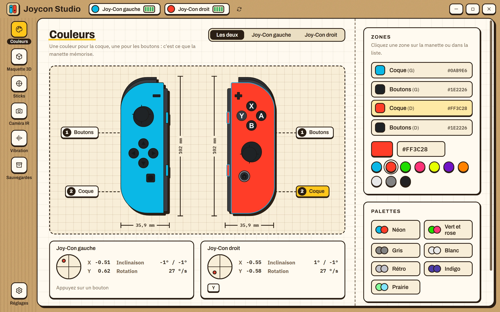
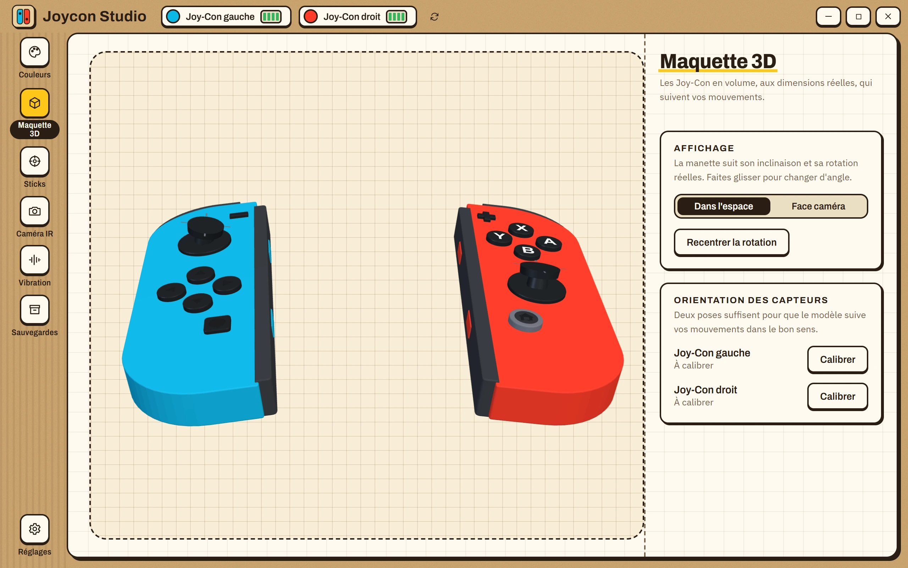
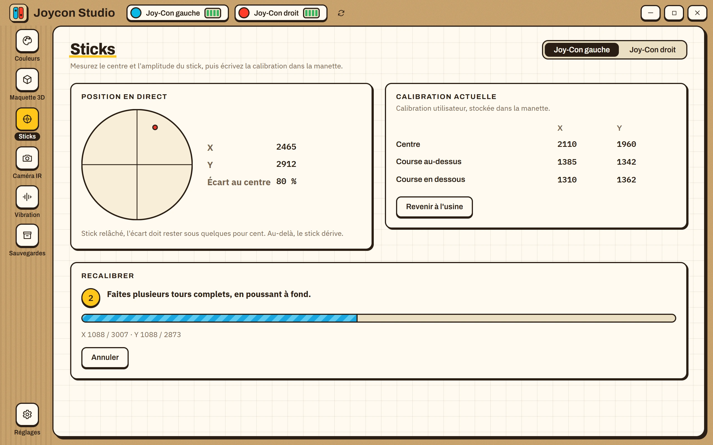
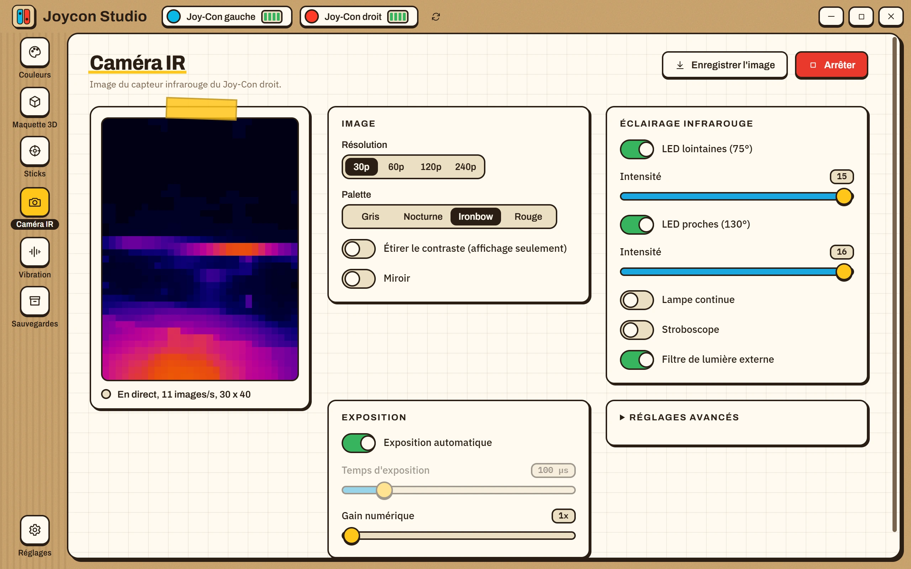
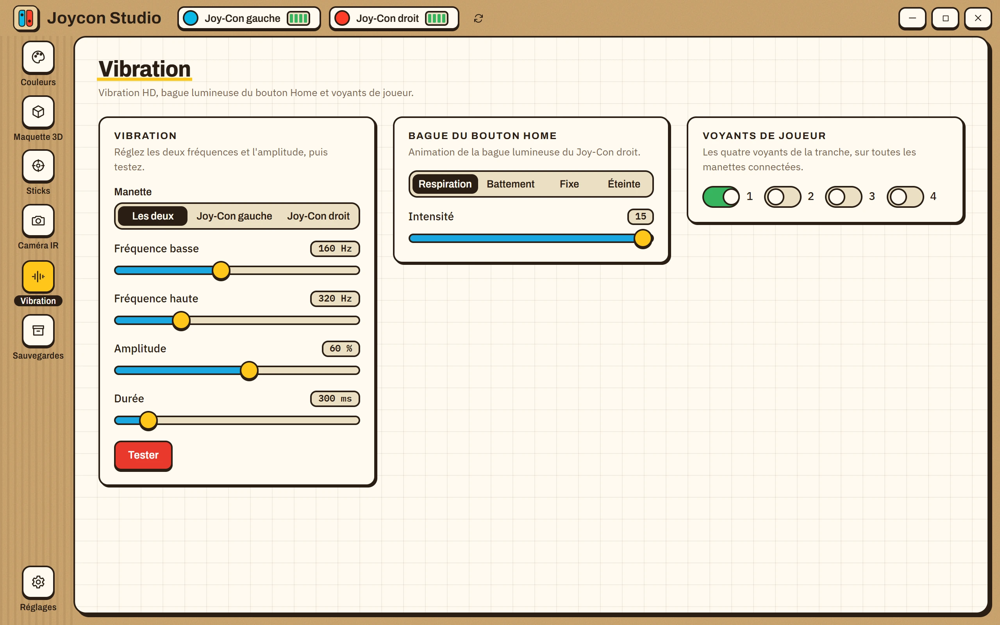
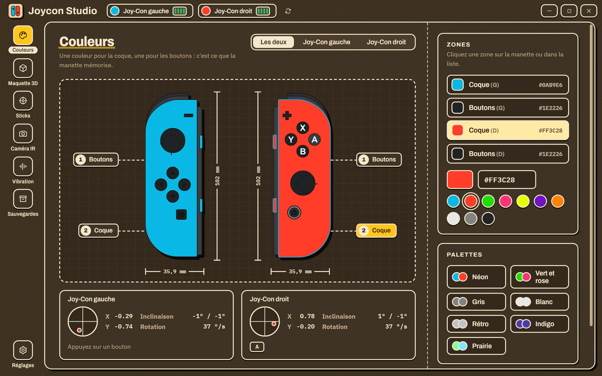

# Joycon Studio

Application de bureau pour Windows qui personnalise les Joy-Con de la Nintendo Switch : couleurs de la coque et des boutons, calibration des sticks, caméra infrarouge, vibration et lumières.

[English](README.md)

<p align="center">
  
</p>

## Fonctions

- **Couleurs** : lecture et écriture des couleurs de coque et de boutons mémorisées par la manette, avec un aperçu des deux Joy-Con et une vue en direct des sticks, des boutons, de l'inclinaison et de la batterie.
- **Maquette 3D** : les deux Joy-Con extrudés à partir des dessins SVG à leur taille réelle (102 x 35,9 mm), qui suivent l'inclinaison et la rotation de la manette, avec les sticks qui basculent et les boutons qui s'enfoncent en temps réel.
- **Sticks** : mesure du centre et de la course d'un stick, écriture d'une calibration utilisateur ou retour à celle d'usine. L'écart au repos indique si un stick dérive.
- **Caméra IR** : image en direct du capteur du Joy-Con droit, quatre résolutions, palettes, réglages des LED, de l'exposition et du bruit, capture PNG.
- **Vibration et lumières** : vibration HD à fréquences réglables, bague lumineuse du bouton Home, voyants de joueur.
- **Sauvegardes** : chaque écriture dans une manette est précédée d'une sauvegarde vérifiée de sa mémoire SPI. Restauration et suppression depuis l'app. Une copie complète de 512 Ko de la puce est aussi possible.
- Français, anglais et espagnol, thèmes clair et sombre, mode démo avec deux Joy-Con simulés.

## Captures

| | |
|:--:|:--:|
|  |  |
| Maquette 3D | Calibration des sticks |
|  |  |
| Caméra IR | Vibration et lumières |

Le thème sombre :

<p align="center">
  
</p>

## Prérequis

- Windows 10 ou 11 avec Bluetooth.
- Joy-Con (L) et/ou (R) de la Switch d'origine, appairés dans les réglages Bluetooth de Windows. Maintenez le petit bouton de synchronisation de la tranche jusqu'à ce que les voyants défilent, puis ajoutez l'appareil.
- Runtime WebView2 (inclus dans Windows 11 et les Windows 10 récents).

Les manettes Switch 2 et la manette Pro utilisent un autre protocole et ne sont pas prises en charge. Elles sont détectées et signalées comme telles.

## Installation

Téléchargez l'installateur (le fichier qui se termine par `-setup.exe`) depuis la page [Releases](../../releases), ou compilez-le (voir plus bas).

L'installateur n'est pas signé : Windows SmartScreen peut afficher « Windows a protégé votre ordinateur ». Cliquez sur **Informations complémentaires**, puis **Exécuter quand même**. Chaque publication contient un fichier `.sha256` : comparez-le au résultat de `Get-FileHash <fichier>` dans PowerShell pour vérifier le téléchargement.

Les Joy-Con se mettent en veille après quelques minutes sans action. Appuyez sur un bouton, puis utilisez le bouton d'actualisation à côté des manettes, en haut de la fenêtre.

## Sécurité

Écrire dans la mémoire d'une manette comporte un risque. L'app le limite :

- Seules deux zones sont modifiables : le bloc de couleurs (`0x6050`, 12 octets) et la calibration utilisateur des sticks (`0x8010`, 24 octets). Tout le reste est refusé.
- Une sauvegarde de la mémoire environnante est lue et enregistrée avant chaque écriture. Si une lecture échoue, rien n'est écrit.
- Chaque écriture est relue et comparée.
- Les sauvegardes sont dans `%APPDATA%\app.joyconstudio\backups`.

## Compiler

Prérequis : Node.js 20 ou plus, la chaîne Rust stable avec la cible MSVC, et le runtime WebView2.

```powershell
npm install
npm run desktop          # fenêtre de développement avec rechargement à chaud
npm run desktop:build    # installateur dans src-tauri/target/release/bundle
```

Vérifications :

```powershell
npx tsc -b               # types
npm run lint
npm test                 # tests unitaires du front
npm run test:rust        # tests unitaires du protocole et des sauvegardes
```

Les tests sur manettes réelles sont ignorés par défaut et ne font que lire les manettes (plus une courte vibration) :

```powershell
cargo test --manifest-path src-tauri/Cargo.toml --lib hardware -- --ignored --nocapture
```

Les captures ci-dessus sont générées par `tools/screenshots.mjs` à partir de l'app en mode démo (lancez-la avec `WEBVIEW2_ADDITIONAL_BROWSER_ARGUMENTS=--remote-debugging-port=9222`).

## Publier une version

Pousser un tag comme `v1.0.0` lance `.github/workflows/release.yml` : il construit l'installateur et le joint, avec sa somme SHA-256, à une publication GitHub.

## Crédits

- [dekuNukem](https://github.com/dekuNukem/Nintendo_Switch_Reverse_Engineering) pour la documentation du protocole des Joy-Con.
- [CTCaer](https://github.com/CTCaer/jc_toolkit) pour jc_toolkit, la référence pour la carte SPI et la caméra IR.

Voir [THIRD-PARTY-NOTICES.md](THIRD-PARTY-NOTICES.md).

## Licence

MIT. Nintendo Switch et Joy-Con sont des marques de Nintendo Co., Ltd. Ce projet est indépendant et n'est pas affilié à Nintendo.
