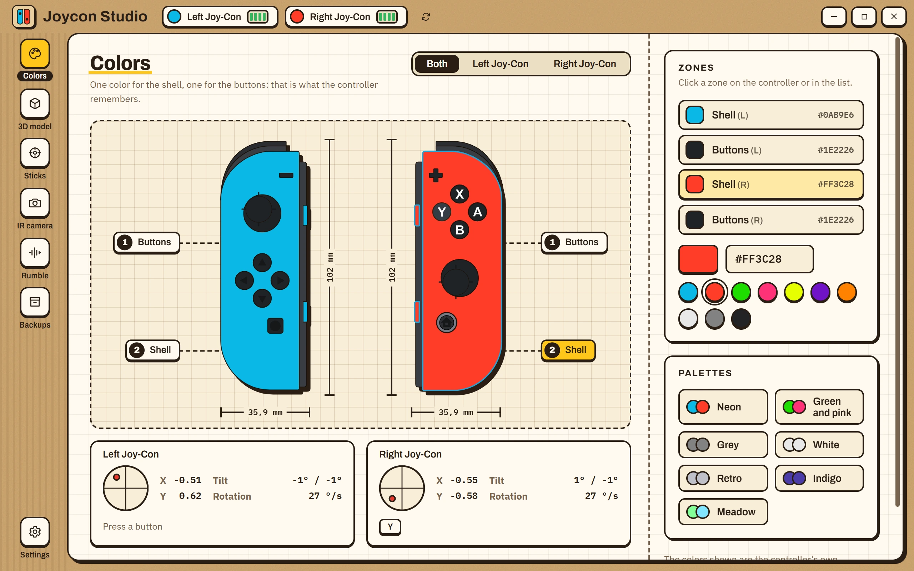
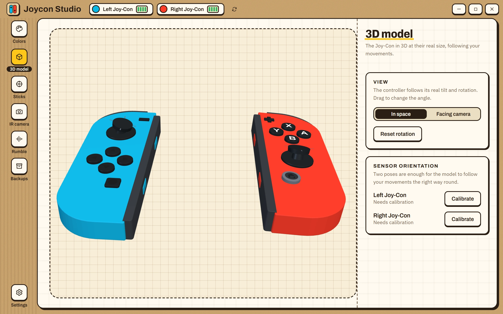
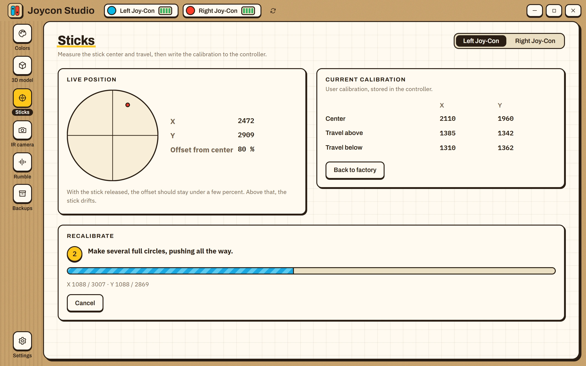
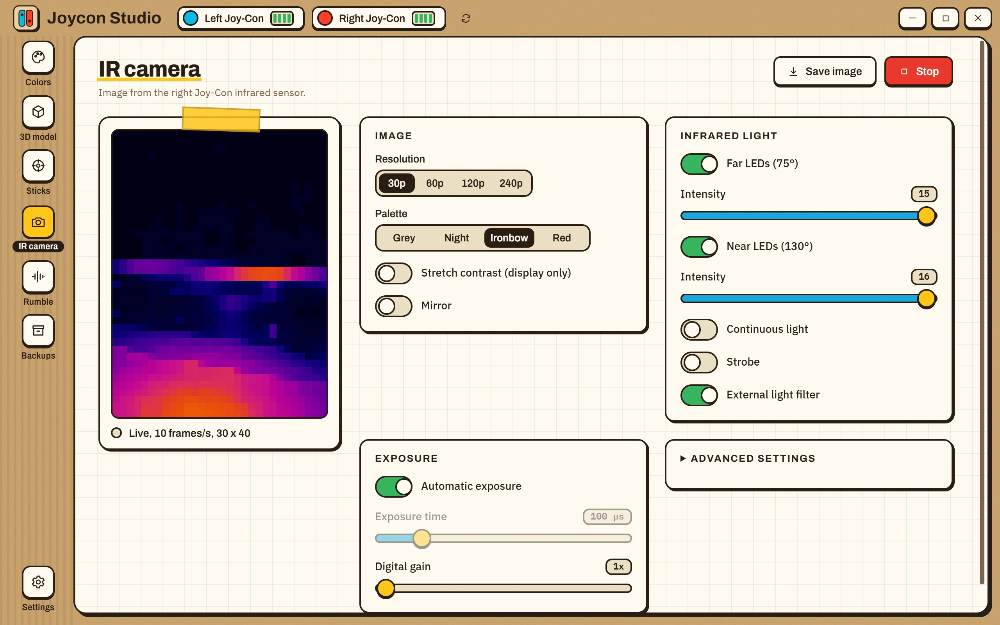
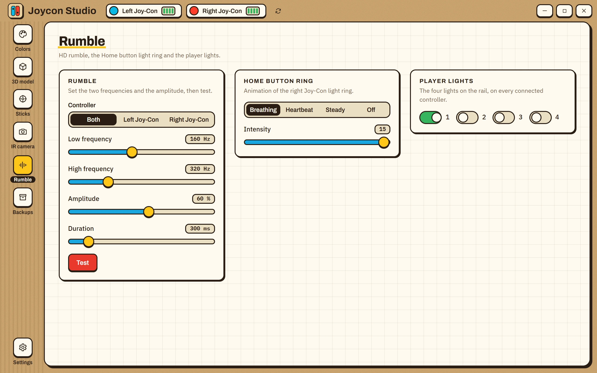
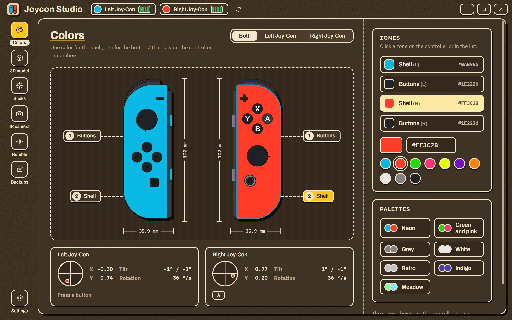

# Joycon Studio

Desktop app for Windows to customize Nintendo Switch Joy-Con: shell and button colors, stick calibration, the infrared camera, rumble and lights.

[Français](README.fr.md)

<p align="center">
  
</p>

## Features

- **Colors**: read and write the shell and button colors stored in the controller, with a live preview of both Joy-Con and a real-time view of sticks, buttons, tilt and battery.
- **3D model**: both Joy-Con extruded from the SVG drawings at their real size (102 x 35.9 mm), following the controller's tilt and rotation, with the sticks tilting and buttons pressing in real time.
- **Sticks**: measure the center and travel of a stick and write a user calibration, or go back to the factory one. Shows the resting offset so you can tell whether a stick drifts.
- **IR camera**: live image from the right Joy-Con sensor, four resolutions, palettes, LED, exposure and noise settings, PNG capture.
- **Rumble and lights**: HD rumble with adjustable frequencies, the Home button light ring, player lights.
- **Backups**: every write to a controller is preceded by a verified backup of its SPI memory. Restore or delete them from the app. A full 512 KB chip copy is available too.
- English, French and Spanish, light and dark themes, demo mode with two simulated Joy-Con.

## Screenshots

| | |
|:--:|:--:|
|  |  |
| 3D model | Stick calibration |
|  |  |
| IR camera | Rumble and lights |

The dark theme:

<p align="center">
  
</p>

## Requirements

- Windows 10 or 11 with Bluetooth.
- Joy-Con (L) and/or (R) from the original Switch, paired in Windows Bluetooth settings. Hold the small sync button on the rail until the lights run, then add the device.
- WebView2 runtime (included in Windows 11 and recent Windows 10).

Switch 2 controllers and the Pro Controller use a different protocol and are not supported. They are detected and listed as unsupported.

## Install

Download the installer (the file ending in `-setup.exe`) from the [Releases](../../releases) page, or build it yourself (see below).

The installer is not code-signed, so Windows SmartScreen may show "Windows protected your PC". Click **More info**, then **Run anyway**. Each release comes with a `.sha256` file: compare it with the output of `Get-FileHash <file>` in PowerShell to check the download.

Joy-Con go to sleep after a few minutes without input. Press a button, then use the refresh button next to the controllers at the top of the window.

## Safety

Writing to a controller's memory carries a risk. The app limits it:

- Only two zones can be written: the color block (`0x6050`, 12 bytes) and the user stick calibration (`0x8010`, 24 bytes). Anything else is refused.
- A backup of the surrounding memory is read and saved before every write. If one read fails, nothing is written.
- Every write is read back and compared.
- Backups are stored in `%APPDATA%\app.joyconstudio\backups`.

## Build from source

Requirements: Node.js 20 or later, the Rust stable toolchain with the MSVC target, and the WebView2 runtime.

```powershell
npm install
npm run desktop          # development window with hot reload
npm run desktop:build    # installer in src-tauri/target/release/bundle
```

Checks:

```powershell
npx tsc -b               # types
npm run lint
npm test                 # front end unit tests
npm run test:rust        # protocol and backup unit tests
```

Tests on real controllers are ignored by default and only read from the controllers (plus a short rumble):

```powershell
cargo test --manifest-path src-tauri/Cargo.toml --lib hardware -- --ignored --nocapture
```

The screenshots above are generated by `tools/screenshots.mjs` from the running app in demo mode (start it with `WEBVIEW2_ADDITIONAL_BROWSER_ARGUMENTS=--remote-debugging-port=9222`).

## Releasing

Pushing a tag such as `v1.0.0` runs `.github/workflows/release.yml`, which builds the installer and attaches it, with its SHA-256 checksum, to a GitHub release.

## Layout

```
src/            React front end (pages, components, stores, i18n)
src-tauri/src/
  protocol.rs   report decoding, SPI blocks, rumble and light encoding
  controller.rs one thread per controller, SPI access, rumble, dump
  ir.rs         infrared camera handshake and fragment assembly
  manager.rs    detection, operations (colors, calibration, backups), demo
  backup.rs     backup files
tools/          development tooling, never part of the shipped build
docs/           screenshots used by the README
```

## Credits

- [dekuNukem](https://github.com/dekuNukem/Nintendo_Switch_Reverse_Engineering) for the Joy-Con protocol documentation.
- [CTCaer](https://github.com/CTCaer/jc_toolkit) for jc_toolkit, the reference for the SPI map and the IR camera.

See [THIRD-PARTY-NOTICES.md](THIRD-PARTY-NOTICES.md).

## License

MIT. Nintendo Switch and Joy-Con are trademarks of Nintendo Co., Ltd. This project is independent and not affiliated with Nintendo.
